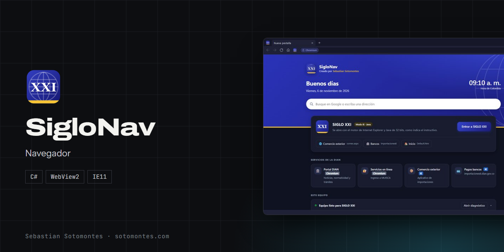
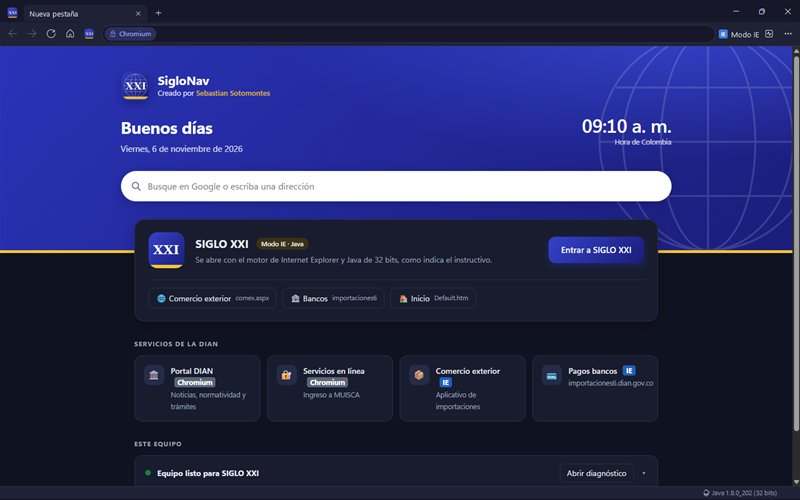
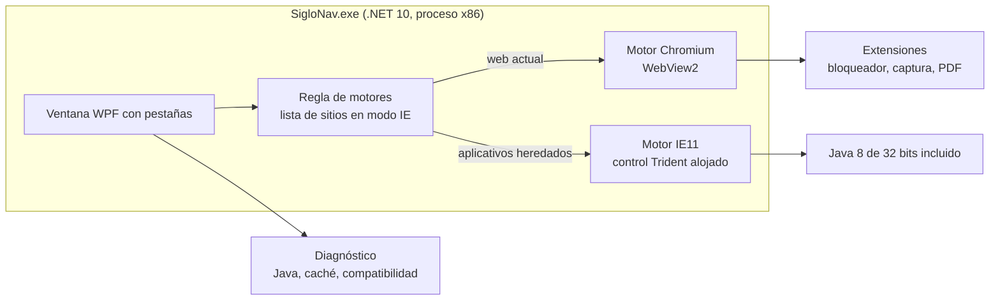

Navegador de doble motor: Chromium para la web actual e Internet Explorer 11 con Java para aplicativos heredados, en la misma ventana.

<a href="https://sotomontes.com/#siglonav"><b>Ver en sotomontes.com</b></a> · <a href="#cómo-se-usa">Cómo se usa</a> · <a href="#cómo-funciona-por-dentro">Cómo funciona</a> · <a href="#novedades">Novedades</a>

| Ficha técnica | |
|---|---|
| **Autor** | Sebastian Sotomontes |
| **Tipo** | Navegador |
| **Plataforma** | Windows 10 y 11, 32 bits |
| **Versión** | 1.1.2 |
| **Estado** | Estable |
| **Stack** | C# · WebView2 · IE11 |
| **Código** | Privado. Esta página es solo una presentación. |

---

## Qué es

SigloNav resuelve un problema muy concreto: aplicativos antiguos, como SIGLO XXI de la DIAN, siguen necesitando Internet Explorer y Java de 32 bits. SigloNav une dos motores en la misma ventana: Chromium para la web actual e Internet Explorer 11 para lo heredado, y trae Java incluido para que no haya que configurar nada.

## Novedades

- Activa Java web sola en los equipos donde estaba deshabilitado.
- Botón directo a SIGLO XXI y extensión de bóveda incluida.
- Java de 32 bits incluido, modo oscuro y extensiones.

## Cómo se usa

1. Instala SigloNav. No necesitas instalar Java aparte.
2. En la página de inicio pulsa **Entrar a SIGLO XXI**, o usa `Ctrl+Mayús+S`. Se abre en modo IE con Java de 32 bits.
3. Navega con normalidad. Las páginas de la lista abren solas en modo IE y el resto sigue en Chromium.
4. Para cambiar de motor en cualquier pestaña pulsa **Modo IE** o `Ctrl+Mayús+E`.
5. Si algo falla, abre **Diagnóstico** para revisar Java, borrar la caché y generar un informe para soporte.

## Funciones

- **Doble motor** en una sola ventana: Chromium e Internet Explorer 11.
- **Modo IE automático** para las páginas de la lista, editable.
- **Java de 32 bits incluido**, sin instalar Java en Windows.
- **Diagnóstico** del equipo y borrado de caché desde el panel.
- **Pestañas** que conservan la sesión en las ventanas emergentes.
- **Tema** claro, oscuro o igual que Windows.

## Detalles

- Accesos directos a Comercio exterior, Bancos, Portal DIAN y MUISCA.
- Las ventanas emergentes conservan la sesión.
- Lista de sitios en modo IE y excepciones de Java editables.
- Bloqueador de anuncios, captura en PNG y guardar en PDF.
- Atajos: `Ctrl+T`, `Ctrl+W`, `Ctrl+L` y zoom con `Ctrl +/-/0`.
- Tema claro, oscuro o igual que Windows.

## Privacidad y seguridad

SigloNav no es un producto de la DIAN ni está afiliado a ella. Internet Explorer, Edge y WebView2 son marcas de Microsoft; Java es marca de Oracle.

## Cómo funciona por dentro

### Arquitectura

### Por qué es un proceso de 32 bits

El plugin de Java que usan estos aplicativos solo carga en 32 bits. Por eso SigloNav es un proceso x86: puede alojar Internet Explorer 11 con ese Java dentro de la misma ventana donde corre Chromium.

### Cómo decide el motor

Cada navegación pasa por una lista editable de sitios. Las páginas de la lista abren en modo IE y el resto en Chromium. El modo IE es "pegajoso" solo dentro de los servidores de SIGLO XXI: mientras navegas ahí se conserva, y un servicio moderno como MUISCA vuelve a Chromium.

### Ventanas emergentes

Los aplicativos antiguos dependen de `window.open` y `window.opener`. SigloNav intercepta esas ventanas y las abre en pestañas que conservan la sesión y la referencia a la ventana padre, para que los flujos sigan funcionando.

### Errores de páginas antiguas

Los errores de JavaScript se cuentan en la barra de estado en lugar de abrir un diálogo por cada uno, lo que hace usables páginas que antes llenaban la pantalla de avisos.

### Java sin instalación

El Java incluido se activa solo para el usuario y solo mientras SigloNav está abierto, sin modificar el resto del sistema. La lista de excepciones se edita sin duplicar ni borrar las entradas existentes.

### Instalación

Instalador por usuario, sin permisos de administrador, autocontenido. Si el equipo no tiene WebView2, lo instala.

---

© 2026 Sebastian Sotomontes. Todos los derechos reservados.
